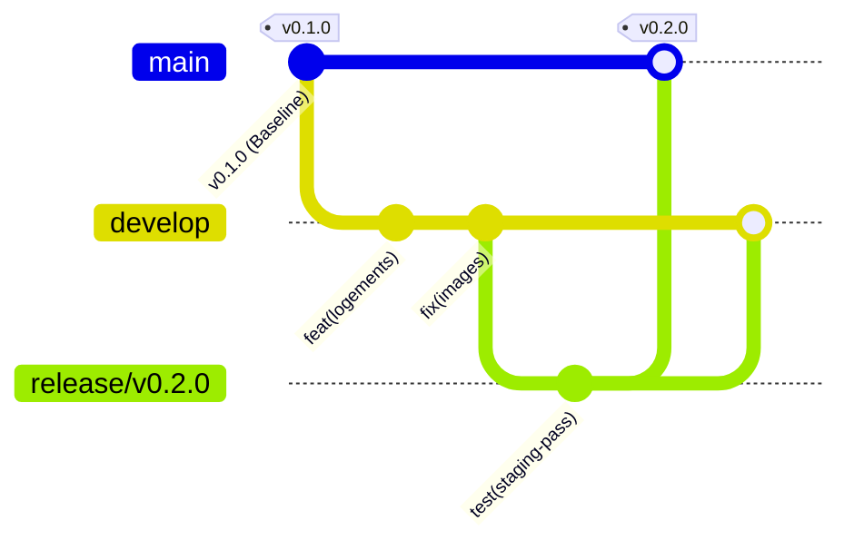

# FEELTOHOME — GUIDE OFFICIEL DE VERSIONNEMENT, DÉPLOIEMENT ET ROLLBACK

> **Projet** : FeelToHome (Plateforme de réservation de résidences et logements meublés)  
> **Workspace** : `c:\Users\DELL\OneDrive\Desktop\feeltohome`  
> **Date de rédaction** : 15 Octobre 2026  
> **Statut du document** : Procédure Opérationnelle Standard (SOP)  

---

## 1. Audit d'Architecture et Version Stable Actuelle

### 1.1 Architecture Technique
- **Frontend** : Next.js 15.2.3 (App Router), React 19.0.0, TypeScript 5.8.2, Tailwind CSS 3.4.17.
- **Backend** : Django 5.1.7, Django REST Framework 3.15.2, Python 3.12 (cible d'hébergement) / Python 3.14 (environnement local), Gunicorn 23.0.0, WhiteNoise 6.8.2.
- **Bases de données** :
  - *Développement local* : SQLite (`backend/db.sqlite3`).
  - *Production* : PostgreSQL managé (connecteur `psycopg` 3.3.6 et configuration dynamique via `dj-database-url`).
- **Hébergement et Routage** :
  - *Frontend* : Vercel (Edge & Serverless).
  - *Backend* : Render.com (Web Service Gunicorn en région Frankfurt).
  - *Routage API* : Fichier `vercel.json` réécrivant les requêtes `/api/(.*)` vers le service backend Django.

### 1.2 État Git et Version Stable de Référence
- **Version actuelle (`package.json`)** : `0.1.0`
- **Branche principale active** : `main` (alignée avec `origin/main`, répertoire de travail propre).
- **Dernier commit validé** : `e77e24a` (*"Apply square borders (rounded-none) to all Navbar elements"*).
- **Branches distantes identifiées** : `origin/main`, `origin/master`, `origin/phase1`.
- **Tags existants** : Aucun tag n'était précédemment créé sur le dépôt.
- **Version Stable Baseline Définie** : `v0.1.0` sur le commit `e77e24a`.

---

## 2. Stratégie de Versionnement Sémantique (SemVer)

FeelToHome adopte strictement la spécification **Semantic Versioning 2.0.0** (`MAJOR.MINOR.PATCH`) :

$$\text{Format : } \mathbf{v[MAJOR].[MINOR].[PATCH]}$$

1. **MAJOR (Majeure)** : Changement d'architecture incompatible, refonte complète des modèles de données ou de l'API publique (ex: passage à `v1.0.0` lors du lancement officiel ouvert au public).
2. **MINOR (Mineure)** : Ajout de fonctionnalités rétrocompatibles (ex: ajout du système de paiement en ligne, module d'avis, filtrage avancé sur carte) -> `v0.2.0`.
3. **PATCH (Correctif)** : Corrections de bugs, optimisations de performance, ajustements de design, correctifs de sécurité sans changement de contrat d'API -> `v0.1.1`.

### Cycle de Vie des Branches Git



- **`main`** : Branche sacralisée de **Production**. Chaque commit sur `main` doit obligatoirement être stable, testé et balisé par un tag Git annoté (`vX.Y.Z`).
- **`develop`** (ou branches de fonctionnalités `feature/*`) : Branche d'intégration continue des développements quotidiens.
- **`staging`** : Branche dédiée au déploiement de préproduction pour validation avant bascule en production.

---

## 3. Matrice des Environnements

| Environnement | Hébergement | Base de Données | Variables Clés | Règle de Données |
| :--- | :--- | :--- | :--- | :--- |
| **Local (Dev)** | `localhost:3000` (Next.js) + `localhost:8000` (Django) | SQLite local (`backend/db.sqlite3`) | `DEBUG=True`<br>`ALLOWED_HOSTS=localhost,127.0.0.1`<br>`CORS_ALLOWED_ORIGINS=http://localhost:3000` | Données fictives issues de `seed_demo`. |
| **Staging (Préproduction)** | Vercel Preview + Render Staging Instance | PostgreSQL Staging ou SQLite isolé | `DEBUG=False`<br>`ALLOWED_HOSTS=staging.feeltohome.com`<br>`CORS_ALLOWED_ORIGINS=https://preview-feeltohome.vercel.app` | Données anonymisées. **Interdiction formelle d'utiliser les secrets ou la base de production.** |
| **Production** | Vercel Production + Render Production (`feeltohome-backend`) | PostgreSQL managé Render | `DEBUG=False`<br>`ALLOWED_HOSTS=feeltohome.com,*.onrender.com`<br>`SECRET_KEY` unique et aléatoire | Données réelles des utilisateurs et propriétaires. Sauvegardes automatiques quotidiennes. |

---

## 4. Pipeline de Validation Avant Publication (Checklist de Release)

Avant de taguer et de publier une nouvelle version, les 5 contrôles obligatoires suivants doivent être exécutés :

### 1. Contrôle de Non-Régression Backend (Django)
```powershell
cd backend
python manage.py test accounts.tests
python manage.py test logements.tests
cd ..
```
*Critère d'acceptation* : 100% des tests doivent être validés (0 échec, 0 erreur).

### 2. Contrôle Statique Frontend (TypeScript & Lint)
```powershell
# Vérification de typage statique
npx tsc --noEmit
```
*Critère d'acceptation* : 0 erreur de typage.

### 3. Contrôle de Build Frontend de Production
```powershell
npm run build
```
*Critère d'acceptation* : Génération réussie de tous les bundles statiques sans erreur de compilation.

### 4. Audit de Sécurité des Dépendances
```powershell
npm audit --audit-level=high
```
*Critère d'acceptation* : Aucune vulnérabilité critique active.

### 5. Audit de Sécurité Déploiement Django
```powershell
cd backend
python manage.py check --deploy
cd ..
```

---

## 5. Procédure Étape par Étape de Création d'une Release

### Étape 1 : Préparation de la version
1. Mettre à jour la version dans `package.json` (ex: `0.2.0`).
2. Mettre à jour le fichier `CHANGELOG.md` en listant les ajouts, modifications et corrections.
3. Commiter ces modifications :
   ```powershell
   git add package.json CHANGELOG.md
   git commit -m "chore(release): prepare release v0.2.0"
   ```

### Étape 2 : Création du Tag Git Annoté
```powershell
git tag -a v0.2.0 -m "Release v0.2.0: Mise à jour des filtres et optimisation des performances"
```

### Étape 3 : Sauvegarde Préalable de la Base de Données
Avant de pousser la release vers la production, effectuer une sauvegarde intégrale (voir Section 7).

### Étape 4 : Déploiement vers Production
```powershell
# Pousser la branche et le tag vers GitHub
git push origin main
git push origin v0.2.0
```
- Vercel détecte automatiquement le commit sur `main` et lance le build frontend.
- Render détecte le push et lance `backend/build.sh` (collectstatic + migrations).

---

## 6. Procédure Complète de Rollback (Retour Arrière Immédiat)

En cas d'anomalie critique survenue après un déploiement, appliquez la procédure suivante :

### 6.1 Rollback Frontend Instantané (Vercel) — Moins de 30 secondes
1. Rendez-vous sur le tableau de bord Vercel : `https://vercel.com/` -> Projet **feeltohome**.
2. Allez dans l'onglet **Deployments**.
3. Repérez le déploiement correspondant à la version stable précédente (identifiable par le tag ou le SHA du commit, ex: `e77e24a` / `v0.1.0`).
4. Cliquez sur les trois points (`...`) à droite du déploiement stable -> **Instant Rollback**.
5. Vercel redirige instantanément 100% du trafic vers ce build sain sans nécessiter de nouveau cycle de compilation.

### 6.2 Rollback Backend (Render)
1. Rendez-vous sur [dashboard.render.com](https://dashboard.render.com/) -> Web Service **feeltohome-backend**.
2. Allez dans l'onglet **Deploys**.
3. Repérez le déploiement précédent réussi.
4. Cliquez sur **Rollback to this deploy**.

### 6.3 Rollback par Git (Alignement du Dépôt)
Pour que le dépôt Git reflète l'état sain restauré :
```powershell
# Option A : Annulation propre via git revert (recommandé pour préserver l'historique)
git revert <commit_défaillant_sha> -m 1 --no-edit
git push origin main

# Option B : Création d'une version corrective d'urgence (Hotfix)
git checkout -b hotfix/revert-v0.2.0 v0.1.0
git commit --allow-empty -m "hotfix: restore v0.1.0 state as v0.2.1"
git tag -a v0.2.1 -m "Hotfix v0.2.1: Rollback d'urgence suite à anomalie de release"
git push origin v0.2.1
```

---

## 7. Stratégie de Sauvegarde et Restauration des Données

> [!CAUTION]
> Un retour arrière du code source (Git/Vercel/Render) **NE RESTAURE PAS** automatiquement les données d'une base de données ayant subi des altérations ou des migrations destructives.

### 7.1 Sauvegarde et Restauration SQLite (Local & Tests)

**Sauvegarde immédiate :**
```powershell
# PowerShell
$timestamp = Get-Date -Format "yyyyMMdd_HHmmss"
Copy-Item "backend/db.sqlite3" -Destination "backend/db.sqlite3.backup_$timestamp"
Write-Host "Sauvegarde SQLite créée : backend/db.sqlite3.backup_$timestamp"
```

**Restauration :**
```powershell
# PowerShell
Copy-Item "backend/db.sqlite3.backup_YYYYMMDD_HHMMSS" -Destination "backend/db.sqlite3" -Force
Write-Host "Base de données SQLite restaurée avec succès."
```

### 7.2 Sauvegarde et Restauration PostgreSQL (Production Render)

**1. Sauvegarde automatique managée :**
Render propose des sauvegardes automatiques quotidiennes sur ses instances PostgreSQL payantes avec rétention 7 jours.

**2. Sauvegarde manuelle par Dump avant release majeure :**
```powershell
# Depuis un terminal sécurisé avec les outils postgres client installés (pg_dump)
pg_dump "$env:DATABASE_URL" -Fc -f "backup_feeltohome_$(Get-Date -Format 'yyyyMMdd_HHmmss').dump"
```

**3. Restauration d'un Dump PostgreSQL :**
```powershell
pg_restore --clean --if-exists --no-owner --no-privileges -d "$env:DATABASE_URL" "backup_feeltohome_YYYYMMDD.dump"
```

### 7.3 Rétrocompatibilité des Migrations Django
Toute migration de schéma ajoutée dans FeelToHome doit être pensée pour être **rétrocompatible** :
- **Ne jamais supprimer une colonne existante** dans la même release où le code cesse de l'utiliser.
- **Règle en 2 temps (Expand and Contract)** :
  1. *Release N* : Ajouter la nouvelle colonne avec `null=True`. Déployer le code qui lit/écrit sur les deux.
  2. *Release N+1* : Migrer les anciennes données, rendre la colonne obligatoire.
  3. *Release N+2* : Retirer l'ancienne colonne.
- **Commande de rollback d'une migration Django** :
  ```powershell
  cd backend
  # Vérifier l'historique des migrations appliquées
  python manage.py showmigrations logements
  
  # Revenir en arrière à une migration spécifique (ex: 0001_initial)
  python manage.py migrate logements 0001_initial
  cd ..
  ```

---

## 8. Synthèse des Commandes Opérationnelles pour FeelToHome

| Tâche | Commande Exacte | Contexte d'Exécution |
| :--- | :--- | :--- |
| **Vérifier statut Git** | `git status ; git log -n 3 --oneline` | Racine du workspace |
| **Tester Backend** | `cd backend ; python manage.py test accounts.tests logements.tests ; cd ..` | Exécuter avant chaque commit |
| **Tester Frontend** | `npx tsc --noEmit` | Racine du workspace |
| **Compiler Frontend** | `npm run build` | Racine du workspace |
| **Créer un Tag Stable** | `git tag -a v0.1.0 -m "Baseline stable FeelToHome" ; git push origin v0.1.0` | Racine du workspace |
| **Sauvegarder SQLite** | `Copy-Item backend/db.sqlite3 backend/db.sqlite3.bak_$(Get-Date -Format 'yyyyMMdd')` | Racine du workspace |
| **Vérifier Déploiement** | `cd backend ; python manage.py check --deploy ; cd ..` | Racine du workspace |
